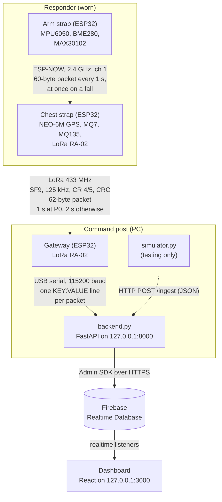

# HALO

HALO monitors a first-responder team in real time. Each responder wears an arm strap and a chest strap (ESP32). Together they measure heart rate, SpO₂, motion and falls, carbon monoxide, air quality, temperature, humidity and GPS position. The data travels over LoRa to a gateway, and a Python backend turns it into alerts, map hazards and analytics in Firebase. A React dashboard shows the team live.

```
Arm strap --ESP-NOW (1 s)--> Chest strap --LoRa 433 MHz (1-2 s)--> Gateway --USB serial--> backend.py --> Firebase --> Dashboard
```

## System architecture



### What runs where

| Part | Runs on | Responsibilities |
|---|---|---|
| Arm strap | ESP32 | Samples the MPU6050 at 100 Hz for fall detection, the no-motion timer and the activity level. Reads the MAX30102 at 50 Hz for heart rate and SpO₂ (filtered beat detection, motion gating, quality score). Reads the BME280 once per second. Sends one packet per second. |
| Chest strap | ESP32 | Reads the MQ7 and MQ135 four times per second (trimmed mean + smoothing). Feeds the GPS (fix filter, fix age) and merges the latest arm packet. Sets its own priority for the send rate and transmits over LoRa. Checks the radio every 2 s and re-initialises it when needed. |
| Gateway | ESP32 on USB | Receives LoRa packets, checks their format and decodes them into one text line with RSSI and SNR. Has the same radio health check, plus a re-init after 60 s without packets. |
| Backend | PC (Python) | Reads the gateway from an auto-detected serial port and validates every reading. Computes heat index, estimated core temperature (from heart rate), physiological strain (PSI), the 15-minute CO average and LoRa packet loss. Runs the alert state machine. Writes live state, history, alerts, map hazards and per-minute and per-session analytics. |
| Firebase | Cloud | Stores the data and pushes changes to the dashboard. |
| Dashboard | Browser | Live view (responder cards, map, detail tabs, alert log) and analytics. It reads Firebase only and never talks to the backend directly. |

### Timing

| Step | Interval |
|---|---|
| Arm → chest | every 1 s; at once when a fall is confirmed |
| Chest → gateway | every 1 s at P0 (MAYDAY), every 2 s otherwise, and at once when the priority gets worse; each packet is about 370 ms on air |
| Backend → Firebase | every packet; minute summaries every 15 s, session summaries every 60 s |
| Link-loss detection | the backend raises LINK LOST after 20 s without data (checked every 5 s); the dashboard greys a responder out after the same 20 s |

From a sensor reading to the dashboard takes about 1–3 s. That figure is worked out from these intervals, not measured on the hardware.

### When something fails

- **Arm strap goes silent:** after 4 s the chest marks it offline. The dashboard shows ARM STRAP OFFLINE, and a fall that was active stays active.
- **LoRa module fault or brown-out:** the chest and gateway notice within 2 s and re-initialise the radio with a 1 → 30 s backoff, without rebooting. The chest keeps sensing meanwhile.
- **Gateway unplugged:** the backend keeps retrying the serial port and reconnects on its own.
- **Whole link lost:** the dashboard keeps the last known values with a LINK LOST badge, and a responder whose last state was MAYDAY stays marked critical.
- **Cold gas sensors:** for the first 3 minutes after the chest powers on, CO and air-quality alerts are held back, because MQ heaters read falsely high while warming up.

## Repository layout

```
firmware/
  arm_strap_v2/arm_strap_v2.ino      MPU6050, BME280, MAX30102; sends to the chest over ESP-NOW
  chest_strap_v2/chest_strap_v2.ino  GPS NEO-6M, MQ7, MQ135; merges arm data, sends over LoRa
  gateway/gateway.ino                LoRa receiver; prints one text line per packet on USB serial
backend/
  backend.py                         serial and HTTP ingest, alert engine, analytics, Firebase writes
  simulator.py                       simulated responder for testing without hardware
dashboard/                           React dashboard (Create React App)
database.rules.json                  Firebase Realtime Database rules (public read, no client writes)
```

## Hardware

| Board | Parts | Pins (ESP32) |
|---|---|---|
| Arm strap | MPU6050, BME280 (0x76), MAX30102 (0x57) | I²C SDA 21, SCL 22 |
| Chest strap | NEO-6M GPS, MQ7, MQ135, LoRa RA-02 | GPS TX→16, RX→17 · MQ7 AO→34 · MQ135 AO→35 · LoRa SCK 18, MISO 19, MOSI 23, NSS 5, RST 14, DIO0 4 |
| Gateway | LoRa RA-02 | same LoRa pins as the chest; USB to the PC |

- The straps run on a 3.7 V Li-ion cell → TP4056 charger → MT3608 boost (5 V) → ESP32 VIN.
- The RA-02 is a 3.3 V part. 5 V destroys it.
- The MQ7 and MQ135 run at 5 V, so their outputs can exceed the ESP32's 3.3 V input limit. Fit a 10 kΩ (AO → GPIO) + 20 kΩ (GPIO → GND) divider on each and set `MQ7_DIVIDER` to `1.5` in the chest sketch.
- Optional battery sensing: TP4056 OUT+ → 100 kΩ → GPIO 33 → 100 kΩ → GND on each strap. The firmware logs the voltage. The dashboard does not show it.

## Firmware

- Arduino IDE, ESP32 core 3.3.x or 4.0.0, board "ESP32 Dev Module". All three sketches compile with 0 warnings on both cores.
- Libraries:
  - Adafruit MPU6050 2.2.9
  - Adafruit BME280 2.3.0
  - Adafruit Unified Sensor 1.1.15
  - Adafruit BusIO 1.17.4
  - SparkFun MAX3010x 1.1.2
  - TinyGPSPlus 1.0.3
  - LoRa (Sandeep Mistry) 0.8.0
- Flash order: gateway, then chest, then arm. Flash all three from the same version, because the arm → chest (60 B) and chest → gateway (62 B) packet formats must match.
- Close the Arduino Serial Monitor on the gateway before starting the backend.

Behaviour worth knowing:

- **Arm strap:**
  - Heart rate and SpO₂ come from a filtered beat detector. The first value appears 8–12 s after the finger is placed (`CAL` until then).
  - Fall detection needs an impact or free-fall, then stillness, plus an orientation change, a hard impact or a long free-fall.
  - A fall stays flagged while the wearer lies still, and clears after 15 s plus 3 s of movement.
  - The radio sleeps between sends to save power (`ARM_RADIO_POWER_SAVE`).
- **Chest strap:**
  - Sends every 1 s at P0 (MAYDAY) and every 2 s otherwise (`TX_P0_MS`, `TX_P1_MS`, `TX_P2_MS`), and immediately when the priority gets worse.
  - Checks the LoRa radio every 2 s and re-initialises it on its own (1 → 30 s backoff, no reboot).
  - Ignores CO/AQI for the first 3 minutes after power-on while the MQ heaters warm up.
- **Gateway:**
  - Has the same radio health check, plus a re-init after 60 s without packets.
  - Status lines starting with `#` are diagnostics.

Calibration:

- **MQ7:** warm the sensor 5+ minutes in clean outdoor air, read `R0(clean)` from the chest Serial Monitor, put it in `MQ7_R0` and re-flash.
- **Finger contact:** tune `FINGER_ON_LEVEL` / `FINGER_OFF_LEVEL` (arm sketch) if HR keeps switching between no contact and calibrating.

## Backend

```
cd backend
pip install fastapi uvicorn pyserial firebase-admin
python backend.py
```

- It needs `serviceAccountKey.json` in `backend/`. Download it from Firebase console → Project settings → Service accounts → Generate new private key. It is a full-admin key, so never commit or share it (it is in `.gitignore`).
- It reads the gateway from the first CP210x, CH340 or FTDI USB-serial port, and serves `POST /ingest`, `GET /summary` and `GET /health` on `http://127.0.0.1:8000`.

| Environment variable | Default | Purpose |
|---|---|---|
| `HALO_COM_PORT` | auto-detect | force the gateway port, e.g. `COM3` |
| `HALO_BENCH` | off | `1` = bench demo with the strap on a table: no-motion (man-down) alerts off, BENCH MODE shown on the dashboard |
| `HALO_PROFILE_AGE` | 30 | responder age for HRmax (208 − 0.7 × age) and heart-rate zones |
| `HALO_HOST`, `HALO_PORT` | 127.0.0.1, 8000 | HTTP bind. Keep loopback: `/ingest` has no authentication |

Windows PowerShell: `$env:HALO_BENCH="1"; python backend.py`.

### Simulator

```
python simulator.py                      # calm, healthy responder (HALO-01)
python simulator.py --mode shift         # 30-minute scenario that triggers every alert, hazard and chart
python simulator.py --mode shift --id HALO-02   # simulated second responder next to real hardware
```

Run the simulator or the hardware for a given ID, not both.

## Dashboard

```
cd dashboard
npm install
npm start          # http://127.0.0.1:3000
```

- The Firebase web config is in `src/firebase.js`. There is no sign-in; access is governed by `database.rules.json`.
- **Live view:**
  - responder cards
  - map with hazard zones, trail, GPS accuracy and command post
  - detail tabs: vitals, environment, movement, device, alerts
  - alert log
- **Analytics view:**
  - training load and HR zones
  - strain, heat and CO exposure
  - activity, SpO₂, HR recovery and session comparison

## Data in Firebase

| Path | Content |
|---|---|
| `live/<id>` | latest state of each responder, including `active_alerts` |
| `readings/<id>` | every packet |
| `alerts/` | alert events: raised, changed, ongoing (every 2 min), cleared |
| `hazards/` | CO, smoke, heat, possible-fire, fall and no-motion points with position |
| `analytics/<id>/minutes`, `analytics/<id>/sessions` | per-minute and per-session summaries |
| `profiles/<id>` | age, HRmax, resting HR |

## Alert rules

| Alert | P1 (warning) | P0 (MAYDAY) | Basis |
|---|---|---|---|
| Fall | – | confirmed fall | arm strap |
| No motion (worn) | 30 s | 60 s | design choice (NFPA 1982 PASS devices alarm at about 30 s) |
| CO | > 35 ppm | > 200 ppm | NIOSH REL (8 h) / NIOSH ceiling |
| CO 15-min average | > 35 ppm | – | project rule |
| Air quality (MQ135 index) | > 300 | – | relative index, not a calibrated AQI |
| Possible fire/smoke | heat index ≥ 39.4 °C and (index > 200 or CO > 35 ppm) | – | project rule |
| SpO₂ | < 94 % | < 90 % | clinical cut-offs |
| Heart rate | > 150 or < 40 bpm | > 170 bpm | design choice |
| Core temperature (estimated from HR) | > 38.5 °C | > 39.5 °C | ACGIH heat-stress limit |
| Heat index | ≥ 39.4 °C | ≥ 51.7 °C | NWS "danger" / "extreme danger" |
| Arm strap offline | arm silent 4 s | – | – |
| Link lost | no data 20 s | if the last state was P0 | – |

Gas alerts are suppressed during the 3-minute MQ warm-up after the chest powers on.

## Limitations

- The MQ7 reading is approximate until R0 is calibrated: no heater cycling, and it is not CO-specific.
- The MQ135 gives a relative air-quality index, not a measured AQI.
- The MAX30102 is not a medical-grade oximeter and is sensitive to motion and finger pressure.
- Core temperature is estimated from heart rate, not measured.
- The BME280 sits near the body and electronics, so it reads warmer than the open air.

## Troubleshooting

| Symptom | Check |
|---|---|
| HR appears and drops out | finger pressure; arm Serial Monitor for `MAX30102 sent no samples` (wiring); flash the latest arm sketch |
| False MAYDAY with the strap on a table | start the backend with `HALO_BENCH=1` |
| Backend: "Can't open COM…" | close the Arduino Serial Monitor |
| Chest/gateway log `radio down` | RA-02 wiring and 3.3 V supply; the radio re-initialises by itself |
| Dashboard shows "Waiting for data" | backend running? gateway plugged in? |
| `npm start`: permission denied | `chmod +x node_modules/.bin/*` or re-run `npm install` |
